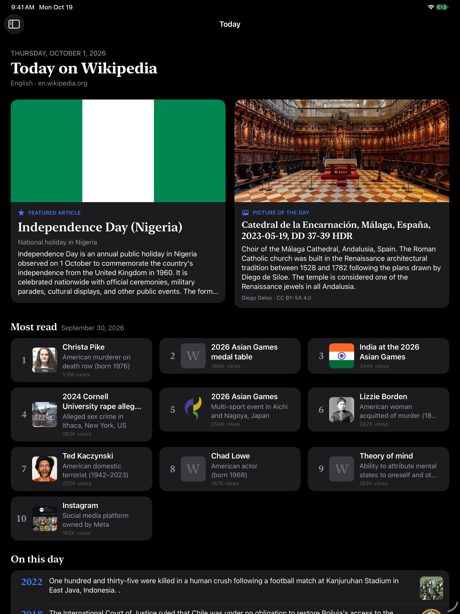
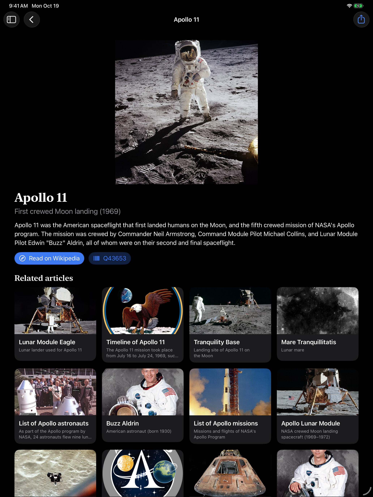
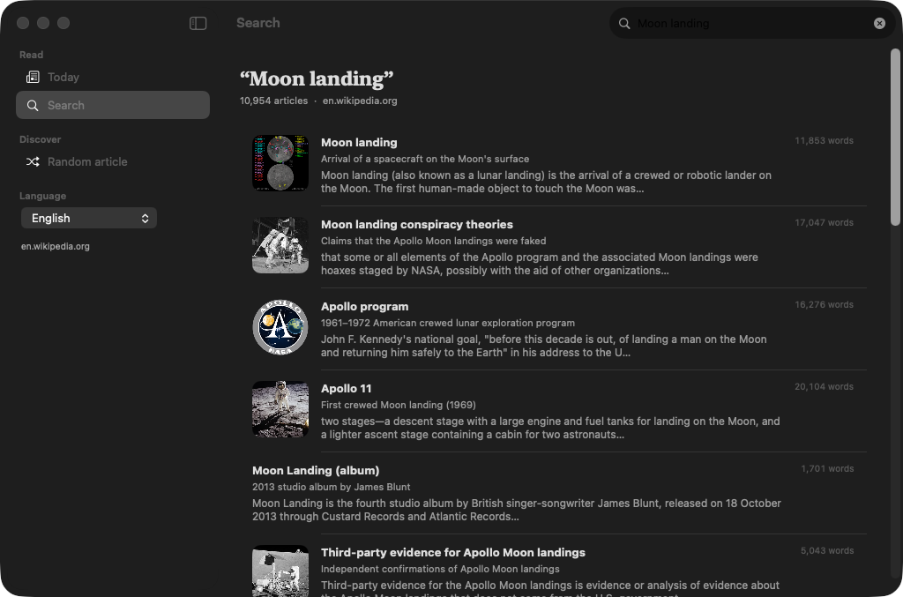

<p align="center">
  
</p>

<p align="center">
  <a href="https://github.com/halilozel1903/WikipediaKit/actions/workflows/ci.yml"></a>
  
  
  
  
  
  <a href="LICENSE"></a>
</p>

**WikipediaKit** is a Swift client for Wikipedia's [REST API](https://en.wikipedia.org/api/rest_v1/) and the [Action API](https://www.mediawiki.org/wiki/API:Search), with SwiftUI views and a reader app for **iPad and Mac**. Fetch page summaries, random and related pages, the daily featured feed (featured article, picture of the day, most read, on this day, in the news) and on this day lists, and search every article, in any of Wikipedia's languages. Every request carries the descriptive User-Agent that Wikimedia requires. No API key, no dependencies.

```swift
import WikipediaKit

let wikipedia = WikipediaClient(userAgent: WikipediaUserAgent(
    appName: "MyReader",
    version: "1.0",
    contact: "https://example.com/myreader"       // or an email address
))

let apollo = try await wikipedia.summary(for: "Apollo 11")
apollo.description                 // the short description
apollo.extract                     // the first paragraph as plain text
apollo.imageURL(width: 960)        // upload.wikimedia.org/…/960px-….jpg

let today = try await wikipedia.featured(on: WikiFeedDate(year: 2026, month: 10, day: 1))
today.featuredArticle?.title
today.pictureOfTheDay?.license                     // such as "CC BY-SA 4.0"
today.mostRead?.articles.first?.views

let results = try await wikipedia.search("Moon landing")
let related = try await wikipedia.related(to: "Apollo 11")
let german = try await wikipedia.language(.german).summary(for: "Mondlandung")
```

## Screenshots

Captured by CI from the example app, *Wiki Reader*, on an iPad simulator and on the Mac, with live data from the Wikipedia APIs on en.wikipedia.org and real images from upload.wikimedia.org. The Today scenes show the featured feed of October 1, 2026 and the article scene shows Apollo 11, so the captures stay the same from run to run. Nothing in these screenshots is bundled or made up.

| iPad: Today | iPad: an article |
| :---: | :---: |
|  |  |




## Features

- **Page summaries**: `summary(for:)` returns the title, display title, short description, first paragraph as text and HTML, thumbnail and original image, Wikidata item, coordinates and links. Redirects are followed and titles are encoded for you (`AC/DC` is one path segment, `AC%2FDC`).
- **Random and related pages**: `randomSummary()` and `related(to:limit:)`. When `/page/related` is not served (Wikimedia has been retiring parts of the REST API), `related` asks the Action API's `morelike:` search instead, which is what the endpoint used. `moreLike(_:limit:)` is also public.
- **The featured feed**: `featured(on:)` decodes `tfa`, `mostread` (with views, rank and view history), `image` (picture of the day with description, artist, credit, license and file page), `onthisday` and `news` into typed models. Parts a day doesn't have are `nil` or empty.
- **On this day**: `onThisDay(_:month:day:)` for `all`, `selected`, `births`, `deaths`, `events` or `holidays`, with B.C. years as `356 BC`.
- **Search**: `search(_:limit:offset:)` is the Action API's `list=search` with the total, a spelling suggestion, snippets (as HTML and plain text) and the next offset. `pageInfo(for:)` adds descriptions and thumbnails for up to 50 titles, following normalization and redirects; `searchArticles(_:limit:)` does both in one call.
- **Any language**: `WikipediaLanguage` covers every edition by its code (`"de"`, `"ja"`, `"zh-yue"`, `"simple"`), with constants and autonyms for large ones. `client.language(.french)` returns a client for another edition; invalid codes are refused before anything is sent.
- **A required User-Agent**: Wikimedia's [User-Agent policy](https://foundation.wikimedia.org/wiki/Policy:Wikimedia_Foundation_User-Agent_Policy) blocks generic clients. `WikipediaUserAgent` builds `MyReader/1.0 (https://example.com/myreader) WikipediaKit/1.0`; it is sent as `User-Agent` and `Api-User-Agent` with every API and image request, and an agent without a name, version or contact is refused before anything is sent.
- **Thumbnails at standard sizes**: `imageURL(width:)` and `WikimediaThumbnail` rewrite upload.wikimedia.org thumbnail URLs to the widths Wikimedia pre-renders (120, 250, 330, 500, 960, 1280, 1920…), never past the original's width. SVGs and videos come back as PNG or JPEG.
- **Robust**: 429, 502, 503 and 504 answers, timeouts and lost connections are retried with backoff, honoring `Retry-After`. REST errors carry the API's problem details, Action API errors their code and info. Models decode leniently: a missing field or one bad element in a list doesn't fail the response.
- **Optional SwiftUI**: the `WikipediaUI` library has `WikiRemoteImage` and `ArticleThumbnail` with a swappable loader (`.wikiImageLoader(.client(wikipedia))` sends your User-Agent with image requests), `ArticleRow` and `WikipediaAttribution`. The client works without it.
- **Testable and Swift 6 ready**: point the client at any `URLSession` and domain. The package's own tests answer every request from a `URLProtocol` stub and JSON fixtures, never the network. Tested with Swift Testing on macOS and on an iPad simulator.

## API coverage

| Endpoint | Method |
| --- | --- |
| `GET /api/rest_v1/page/summary/{title}` | `summary(for:)` → `PageSummary` |
| `GET /api/rest_v1/page/random/summary` | `randomSummary()` → `PageSummary` |
| `GET /api/rest_v1/page/related/{title}` | `related(to:limit:)` → `[PageSummary]` |
| `GET /w/api.php?action=query&generator=search&gsrsearch=morelike:{title}` | `moreLike(_:limit:thumbnailWidth:)` → `[PageSummary]` (and the fallback of `related`) |
| `GET /api/rest_v1/feed/featured/{yyyy}/{mm}/{dd}` | `featured(on:)` → `FeaturedContent` (`featuredArticle`, `mostRead`, `pictureOfTheDay`, `onThisDay`, `news`) |
| `GET /api/rest_v1/feed/onthisday/{type}/{mm}/{dd}` | `onThisDay(_:month:day:)`, `onThisDay(_:on:)` → `OnThisDay` |
| `GET /w/api.php?action=query&list=search&srsearch=…&format=json` | `search(_:limit:offset:)` → `SearchResults` |
| `GET /w/api.php?action=query&prop=pageimages\|description&titles=…` | `pageInfo(for:thumbnailWidth:)` → `[String: PageInfo]` |
| search, then descriptions and thumbnails | `searchArticles(_:limit:thumbnailWidth:)` → `(SearchResults, [SearchHit])` |
| an image on upload.wikimedia.org | `imageData(from:)` → `Data`, with the User-Agent |
| anything else | `rest(_:path:)` and `action(_:query:)` decode any endpoint into your own `Decodable` |

Requests go to `https://{language}.wikipedia.org`. Action API requests add `format=json&formatversion=2`.

## Installation

In Xcode choose **File › Add Package Dependencies…** and enter:

```
https://github.com/halilozel1903/WikipediaKit
```

Or add it to `Package.swift`:

```swift
dependencies: [
    .package(url: "https://github.com/halilozel1903/WikipediaKit", from: "1.0.0")
],
targets: [
    .target(name: "MyApp", dependencies: [
        .product(name: "WikipediaKit", package: "WikipediaKit"),
        .product(name: "WikipediaUI", package: "WikipediaKit"),   // optional SwiftUI views
    ])
]
```

## Usage

### The User-Agent

Wikimedia asks every client to say who it is and how to reach its author, and blocks requests that don't. There is no default agent; pass yours when you create the client:

```swift
let agent = WikipediaUserAgent(appName: "MyReader", version: "2.1", contact: "myreader@example.com")
agent.value      // "MyReader/2.1 (myreader@example.com) WikipediaKit/1.0"
agent.isValid    // true; agent.problem says what is missing otherwise

let wikipedia = WikipediaClient(userAgent: agent)            // English Wikipedia
let french = WikipediaClient(userAgent: agent, language: .french)
```

### Pages

```swift
let page = try await wikipedia.summary(for: "Apollo 11")
page.title              // "Apollo 11"
page.displayTitle       // display title as plain text
page.description        // the short description, from the article or Wikidata
page.extract            // first paragraph, plain text
page.extractHTML        // first paragraph, HTML
page.thumbnail          // WikiImage(source:width:height:), about 330 px wide
page.originalImage      // the lead image at full size
page.imageURL(width: 960)
page.wikidataItem       // "Q43653", the Wikidata item
page.coordinates        // for places
page.webURL             // https://en.wikipedia.org/wiki/Apollo_11

let random = try await wikipedia.randomSummary()
let related = try await wikipedia.related(to: "Apollo 11", limit: 12)
```

### Today: the featured feed

```swift
let feed = try await wikipedia.featured(on: .today)           // days are in UTC
let day = try await wikipedia.featured(on: WikiFeedDate(year: 2026, month: 10, day: 1))

day.featuredArticle?.extract
for article in day.mostRead?.articles.prefix(10) ?? [] {
    print(article.rank ?? 0, article.page.title, article.views)
}
if let picture = day.pictureOfTheDay {
    picture.displayTitle        // file name without "File:" and the extension
    picture.plainDescription
    picture.plainArtist
    picture.license             // such as "CC BY-SA 4.0"
    picture.filePageURL         // full attribution on Wikimedia Commons
    picture.imageURL(width: 1280)
}
day.onThisDay.first?.yearText
day.news.first?.story           // plain text; storyHTML has the links
```

News is only in the current day's feed, and the most-read list counts the day before.

### On this day

```swift
let births = try await wikipedia.onThisDay(.births, month: 7, day: 20)
births.births.first?.text

let all = try await wikipedia.onThisDay(on: .today)
all.list(.all)          // events, births and deaths, newest first, then holidays
```

### Search

```swift
let results = try await wikipedia.search("Moon landing", limit: 20)
results.totalHits                  // every match
results.suggestion                 // "Did you mean…"
results.results.first?.snippet     // matching text, plain
results.results.first?.snippetHTML // with <span class="searchmatch">
if let next = results.nextOffset {
    let more = try await wikipedia.search("Moon landing", limit: 20, offset: next)
}

// Search results have no images; add descriptions and thumbnails in one more request.
let (page, hits) = try await wikipedia.searchArticles("Moon landing")
hits.first?.description
hits.first?.thumbnail?.source
```

### Languages

```swift
let japanese = wikipedia.language(.japanese)                  // ja.wikipedia.org
let cantonese = wikipedia.language("zh-yue")
let summary = try await japanese.summary(for: "アポロ11号")

WikipediaLanguage.common                 // large editions for a picker
WikipediaLanguage.german.autonym         // "Deutsch"
WikipediaLanguage.hebrew.isRightToLeft   // true
```

### Images

```swift
page.imageURL(width: 500)                // a standard width, from the thumbnail URL
WikimediaThumbnail.standardWidths        // [20, 40, 60, 120, 250, 330, 500, 960, 1280, 1920, 3840]
WikimediaThumbnail.url(thumbnailURL, width: 800, originalWidth: 1200)   // …/960px-…

let data = try await wikipedia.imageData(from: url)   // with your User-Agent
```

### Configuration and errors

```swift
let wikipedia = WikipediaClient(configuration: WikipediaConfiguration(
    userAgent: agent,
    language: .english,
    session: .shared,
    maxRetries: 3,              // default 2, for 429, 502, 503, 504 and timeouts
    timeout: 20,
    relatedFallback: true       // morelike: search when /page/related is not served
))

do {
    _ = try await wikipedia.summary(for: "No such page here")
} catch let error as WikipediaError {
    switch error {
    case .notFound(let problem, _): print(problem?.detail ?? "")   // "Page or revision not found."
    case .http(let status, let problem, _): break                   // 403 when blocked, 429 when busy
    case .api(let code, let info): break                            // Action API errors
    case .decoding, .transport, .invalidResponse: break
    case .invalidUserAgent(let reason): break                       // nothing was sent
    case .invalidRequest(let reason): break                         // empty search, bad language…
    }
}
```

### SwiftUI views

```swift
import WikipediaKit
import WikipediaUI

List(articles) { article in
    ArticleRow(page: article.page, rank: article.rank, detail: article.views.compactViews)
}
ArticleThumbnail(page: page, width: 500).frame(height: 200)
WikiRemoteImage(url: picture.imageURL(width: 960))
WikipediaAttribution(page: page)    // "Text from Wikipedia, available under CC BY-SA 4.0 · Source"

ContentView()
    .wikiImageLoader(.client(wikipedia))   // image requests carry your User-Agent
```

## Example app

The `Example` folder contains *Wiki Reader*, built with WikipediaKit and WikipediaUI, with one set of views for both platforms:

- **Today**: the featured article, the picture of the day with its author and license, the ten most-read articles with their views, On this day and In the news.
- **Search**: full-text search with each result's thumbnail, description, snippet and length, and the API's spelling suggestion.
- **Articles**: the summary with the lead image, description, first paragraph, links to Wikipedia and Wikidata, and related articles.
- **Random article** and a **language picker** for 22 large editions, in the sidebar.

The project uses [XcodeGen](https://github.com/yonaskolb/XcodeGen) so no project file has to live in the repo:

```bash
brew install xcodegen
cd Example && xcodegen generate
open WikiReader.xcodeproj
```

Run `WikiReader` on an iPad simulator or `WikiReaderMac` on your Mac. The app always uses the live APIs. Launch with `-screenshot today|article` (iPad) or `-screenshot today|search` (Mac) to open a fixed scene, as CI does for the screenshots above.

## Content and licenses

Text from Wikipedia is available under the [Creative Commons Attribution-ShareAlike 4.0 License](https://creativecommons.org/licenses/by-sa/4.0/); images on Wikimedia Commons each have their own license, which the picture of the day model exposes (`license`, `licenseURL`, `filePageURL`). When you show Wikipedia content, credit it and link to the source; `WikipediaAttribution` does that. Please follow the [API etiquette](https://www.mediawiki.org/wiki/API:Etiquette) and the [Terms of Use](https://foundation.wikimedia.org/wiki/Policy:Terms_of_Use).

WikipediaKit is an unofficial client. It is not affiliated with or endorsed by the Wikimedia Foundation; Wikipedia is a trademark of the Wikimedia Foundation. The JSON fixtures used by the unit tests are hand-written in the shapes of the published API schemas; the app icon and banner are original artwork made for this package.

## Requirements

- Xcode 26 or later (Swift 6.2 toolchain)
- iPadOS 17+ or macOS 14+ (the client also runs on iOS 17+)

## Contributing

Issues and pull requests are welcome. Please run the tests before opening a PR:

```bash
swift test
bash scripts/test.sh iOS
```

## License

WikipediaKit is available under the MIT license. See [LICENSE](LICENSE).
